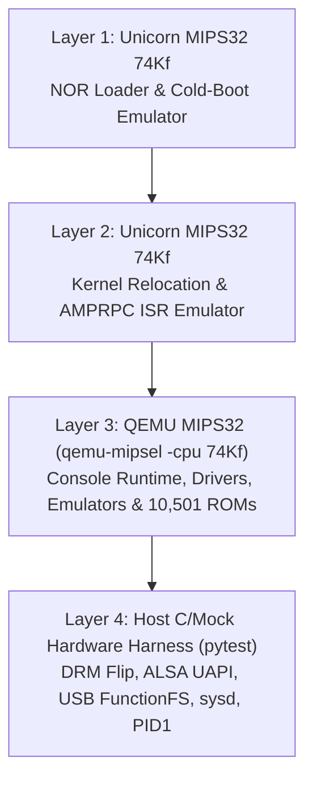

# HC16E310 / R36S Console Emulation & Verification Stack

> [!IMPORTANT]
> **Hardware vs. Emulation Scope:** Offline emulation validates MIPS32 machine code, NOR loader control flow, kernel relocation, userspace ABI compatibility, and libretro core execution **without** contacting real hardware. Real hardware trials on the HiChip HC16E310 (single R36S-clone / SF3000-family unit) are tracked separately in `AGENT_HANDOFF.ru.md` and `analysis/boot_crypto/*_trial.json`.

This repository uses a **4-layer offline console emulation stack** to validate every bootloader shim, Linux `7.2.0-rc5` kernel image, driver `.so`, standalone emulator, and game ROM before flashing or running on the physical HC16E310 handheld.

---

## Architecture Overview



---

## Layer 1 — Unicorn MIPS32 74Kf NOR Loader & Cold-Boot Emulator

Before any cold-boot image (`advapi32.dll`) is ever staged on the console SD card, its exact encrypted payload and MIPS32 shim bytes are executed inside Unicorn (`UC_ARCH_MIPS`, `UC_MODE_MIPS32 | UC_MODE_LITTLE_ENDIAN`, `UC_CPU_MIPS32_74KF`):

- **Primary scripts:**
  - `scripts/boot_crypto/emulate_loader_fs_probe.py` — Full cold-boot + early-restore + stock-fallback emulator.
  - `scripts/boot_crypto/emulate_loader_image.py` — Validates loader decompression and entry handoff.
  - `scripts/boot_crypto/emulate_loader_cipher.py` — Verifies HC16xx NOR payload key recovery & decryption (`codec.py`).
  - `scripts/boot_crypto/emulate_loader_wait.py` — Verifies watchdog timing and wait loops.
  - `scripts/boot_crypto/emulate_direct_candidate.py` & `emulate_boot_names.py` — Validates direct boot candidate naming and layout.
- **Emulated HC16E310 Address Space (`emulate_loader_fs_probe.py`):**
  - `0x00000000` (64 MiB): Main RAM (decompressed kernel / shim / probe image).
  - `0x09D00000` (3 MiB): Stock NOR loader (`tpl_decrypted.bin` unpacked at `0x09DA0000`), including native decrypt wrapper (`0x89dab188`) and `bootm` (`0x89daa840`).
  - `0x18800000` & `0x18818000` (4 KiB each): HC16E310 MMIO (watchdog, clock/sysctrl, IRQ masks).
  - Stubbed NOR filesystem APIs (`OPEN`, `READ`, `WRITE`, `CLOSE`, `RESOLVE`, `GET_FILE_POINTER`, `FAT_SYNC`) with exact CRC32 verification of restored `advapi32.dll` and restore receipts (`RESTORE_MAGIC`).
- **Pre-Hardware Gate (`v43` status):**
  - Every cold candidate (including `payload/kernel_cold_full_session_v43`, `watchdog_seconds=90`) must pass **`8/8` cold-restore scenarios** + **`1/1` native stock-fallback scenario** (simulating read/write/CRC failures and confirming safe recovery via native decrypt/bootm to stock Linux 4.4 or terminal 5s watchdog stub at `0x80f00000`).

---

## Layer 2 — Unicorn MIPS32 Kernel Relocation & AMPRPC ISR Emulators

- **Kernel Relocation & Head Entry (`scripts/kernel_lab/emulate_boot.py`):**
  - Maps 64 MiB RAM (`UC_CPU_MIPS32_74KF`), loads the real relocation machine-code stub (`r36_reloc_start` .. `r36_reloc_end`) extracted from `r36boot.ko`, verifies zero unresolved relocations, replays scattered page copies + CRC32 check, and executes MIPS Linux `vmlinux.elf` head code up to `start_kernel` while verifying UHI arguments (`fw_arg0`, `fw_arg1` / FDT pointer) and `init_thread_union` stack setup.
- **AMPRPC Mailbox ISR (`scripts/kernel_lab/emulate_amprpc.py`):**
  - Executes the stock AMPRPC interrupt service routine (`0x802BA840`..`0x802BA9C8`) against synthetic HC16xx mailbox registers mapped at `0x18800000` and `0x18866000` (8 status words, pending-clear simulation, stuck-ACK edge cases) to verify register recovery without touching hardware.

---

## Layer 3 — QEMU MIPS32 (`qemu-mipsel -cpu 74Kf`) Console Runtime & Game Emulator Testbed

Inside the 6-core WHPX Alpine Linux build VM (`analysis/kernel_build_vm_v1`), real console MIPS32 ELF binaries are executed under `qemu-mipsel -cpu 74Kf` using the **actual console dynamic linker and libraries** (`/cubegm/lib/ld.so.1`, `/cubegm/lib:/cubegm/usr/lib`, glibc 2.19) alongside a 7-symbol mock `driver_r36_combined` backend (`video_drivers_init`, `video_driver_disp_frame`, `video_driver_deinit`, `sound_driver_init`, `sound_driver_playframe`, `sound_driver_flush`, `sound_driver_deinit`).

### 3.1 Driver & Shared-Library Audit (`analysis/driver_port/EMULATORS_OFFLINE_v1_RESULT.json`)

- **`driver_r36_combined_v1.so`:** `RTLD_NOW` `dlopen` **PASS** (all 7 video + audio ABI exports resolve against console glibc `<= 2.4`).
- **All `113` `.so` files in `/cubegm/cores/`:**
  - **`106` PASSED** (`84` `*_libretro.so` cores passed `dlopen(RTLD_NOW)` + `retro_api_version` + `retro_get_system_info`; `22` `libemu_*.so` shims passed `dlopen`).
  - **`7` FAILED** `dlopen`: `gpsp_multicore_libretro.so` (`undefined symbol: __cmpdi2`) and 6 legacy stock shims (`libemu_fba3100.so`, `libemu_nes.so`, `libemu_nestopia.so`, `libemu_pgm.so`, `libemu_stella.so`, `libemu_vbam.so`).
- **`frogui_libretro.so` Core Reference Cross-Check:**
  - `90` explicit `/mnt/sdcard/cubegm/cores/*_libretro.so` paths found inside TreeFrogUI: **`80` PASS**, **`1` FAIL** (`gpsp_multicore_libretro.so`, while `gpsp_libretro.so`, `mgba_libretro.so`, and `vba_next_libretro.so` all pass), and **`9` optional cores** absent from stock SD (`bluemsx`, `butterscotch`, `classicube`, `duke3d`, `jaxe`, `mcpe`, `openclaw`, `vaporspec`, `vice_xvic`).

### 3.2 Standalone Emulators Audit (7 Binaries)

| Binary | `ld.so.1 --list` | `qemu-mipsel` Runtime Status | Notes / Findings |
|---|---|---|---|
| `picoarch` | PASS | **PASS** (`rc=0`) | Video + audio init (`48000 Hz`, 2 ch) + real frame rendering across cores |
| `picoarch_hi` | PASS | **PASS** (`rc=0`) | High-memory base for `gpsp_libretro.so` & `pcsx_rearmed_libretro.so` |
| `rockbox` | PASS | **PASS** (`rc=0`) | Renders `320x240` + `sound_driver_init(48000, 2)` with `SDL_VIDEODRIVER=dummy SDL_AUDIODRIVER=dummy` (`rockbox.sh`) |
| `dsperate` | PASS | **PASS** (`rc=0`/`2`) | Requires its own bundled `dsperate/lib/ld.so.1` & `dsperate/lib` (needs `GLIBC_2.25..2.36`, handled by `run_sf3000.sh`) |
| `pico286` | PASS | **PARTIAL (Audio ABI gap)** | Renders `640x480` (`rc=0`), but calls `sound_driver_init()` with **0 arguments** (`0x00401f44..0x00401f50`), which `audio_alsa_backend.c` rejects (`< 8000 Hz` validation) |
| `lgpt.elf` | PASS | **ENV REQUIRED** | Segfaults on missing `/dev/fb0` without `SDL_VIDEODRIVER=dummy`; with `SDL_VIDEODRIVER=dummy SDL_AUDIODRIVER=dummy` renders frame #1 (`640x480`) |
| `pcsx4all` | PASS | **BLOCKED w/o `/dev/fb0`** | Unconditionally calls `open("/dev/fb0", O_RDWR)` at `0x004071d0` (`rc=1` without `CONFIG_DRM_FBDEV_EMULATION`). Use `pcsx_rearmed_libretro.so` via `picoarch_hi` for PS1. |

### 3.3 Exhaustive Full-SD Game Audit (`10,501` ROMs — `analysis/driver_port/ALL_GAMES_EMULATORS_OFFLINE_v1_RESULT.json`)

Every single ROM from `backup/r36s_sd_16gb.img` (FAT32 @ offset `16384`, 15 folders) was executed on real MIPS32 cores under `qemu-mipsel -cpu 74Kf` with real frame & audio callback verification:

- **Console & Handheld Systems (`14` folders, `7,361` games): `7,361 / 7,361` (100.0% PASS)**
  - `FC` (`2,907/2,907`, `fceumm_libretro.so`), `SFC` (`2,145/2,145`, `snes9x2005_plus_libretro.so`), `GBA` (`942/942`, `gpsp_libretro.so` with `gba_bios.bin`), `PCE` (`377/377`, `mednafen_pce_fast_libretro.so`), `MD` (`341/342` `picodrive_libretro.so` + `tribe.bin` rescued by `genesis_plus_gx_libretro.so` = `342/342`), `GB` (`192/192`, `gambatte_libretro.so`), `GBC` (`149/149`, `gambatte_libretro.so`), `SMS` (`93/93`, `gearsystem_libretro.so`), `GG` (`91/91`, `gearsystem_libretro.so`), `WSC` (`63/63`, `mednafen_wswan_libretro.so`), `NGPC` (`39/39`, `race_libretro.so`), `PS` (`10/10`, `pcsx_rearmed_libretro.so`), `ATARI` (`9/9`, `stella2014_libretro.so`), `ROMS` (`2/2`, `fceumm_libretro.so`).
- **Arcade (`MAME`, `3,140` files mounted directly from `/mnt/sd/mame` with parent ROMs + `neogeo.zip`/`pgm.zip`, strictly filtering out `fbneo`'s `640x480` error screen):**
  - **`2,511` verified rendering real game frames:** `fbneo_libretro.so` (`2,096`), `mame2003_plus_libretro.so` (`290`), `fbalpha2012_neogeo_libretro.so` (`107`, requires `neogeo.zip` co-located beside ROMs), `fbalpha2012_cps1_libretro.so` (`9`), `mame2000_libretro.so` (`5`), `fbalpha2012_cps2_libretro.so` (`4`).
  - **`335` `.zip` files:** hit user-mode `qemu-mipsel` `SIGBUS` (MIPS signal `10`) due to unaligned memory accesses; `qemu-mipsel` lacks the Linux MIPS kernel `do_ade` unaligned trap emulator that runs automatically on real R36S Linux 7.2 hardware.
  - **`55` `.fba` files:** legacy stock FBA3100 proprietary format (not standard libretro `.zip` romsets).
  - **`239` `.zip` files:** unresolved across tested arcade cores (missing parent/BIOS or mismatched romset version; exact filenames recorded in the JSON report).
- **Tier-A End-to-End `picoarch` / `picoarch_hi` Frontend Smoke (`28` core/system combinations):**
  - **`22 / 28` PASS** (`rc=0`, 2 rendered frames through mock `driver_r36_combined`), `4` `qemu-mipsel` `SIGBUS` (`rc=135`: `snes9x2010`, `snes9x-Z`, `fbneo` on `1941.zip`, `fbalpha2012_cps1` on `1941.zip`), `2` `rc=255` (`mame2003_plus`, `mame2000` on `1941.zip`).

---

## Layer 4 — Host C/Python Hardware-Mock Suite (`pytest`)

Runs on Windows/Linux host without any console attached (`313 passed, 14 skipped` in the latest run):

```bash
python -m pytest scripts -q
```

Key emulated hardware test modules:
- `scripts/peripheral_lab/test_combined_driver_backend.py` & `video_backend_test.c` — Mock DRM double-buffer scanout verification (hashes active scanout buffer on every flip, injects `DRM_IOCTL_MODE_PAGE_FLIP` failures, timeouts, and stale flip events) interleaved with ALSA warmup/playframe.
- `scripts/peripheral_lab/test_audio_alsa_backend.py` — Mock 12-word `r36_hc16xx_i2s` ALSA PCM UAPI and resampling tests.
- `scripts/peripheral_lab/test_r36_sysd.py` — Mock evdev/sysfs/ADC/MMIO daemon tests (direct keys, GPIO15/19 PA policy, brightness persistence, fade & auto-poweroff).
- `scripts/peripheral_lab/test_r36_session_init.py` — Mock PID1 session supervisor tests (pre-mount chkdsk gate, `picoarch`/`picoarch_hi`/`.sh` game launch routing, `TF_DRIVER=` env, clean `RB_POWER_OFF`).
- `scripts/peripheral_lab/test_usb_ffs_mtp_adb.py` — Composite FunctionFS v2 MTP + ADB descriptor and protocol verification.
- `scripts/peripheral_lab/test_full_kernel_profile.py` — Unified `r36-full.dts` (`r36_display`, `pwm-backlight`, `r36-direct-keys`, `r36-serial-keys`, USB OTG) validation.
